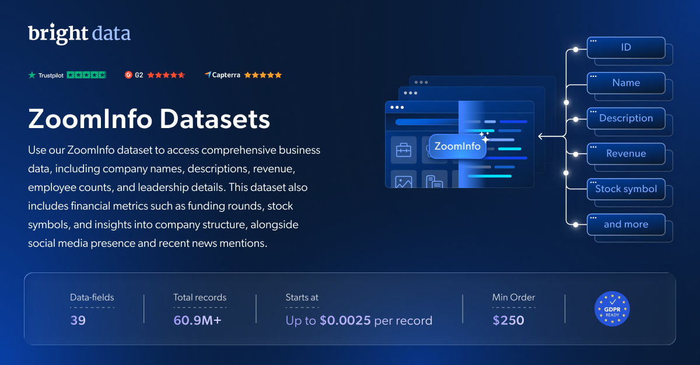

# ZoomInfo-dataset-samples

<h2>包含 1001 家 ZoomInfo 公司的样本数据集</h2>

<a href="https://www.bright.cn/products/datasets/zoominfo">
   
</a>

包含 1000 多家公司的 ZoomInfo 数据集样本。该数据集使用 <b>Bright Data API</b> 提取。

<h2>数据集中包含的部分数据点：</h2>

* ```id```：帖子的唯一标识符
* ```user_posted```：帖子发布者的用户名
* ```name```：帖子发布者的姓名
* ```description```：帖子的文本描述
* ```date_posted```：帖子的发布日期
* ```photos```：帖子所附照片的 URL
* ```videos```：帖子所附视频的 URL
* ```url```：帖子的 URL 链接
* ```quoted_post```：主帖子中引用帖子的详细信息
* ```tagged_users```：帖子中标记的个人资料列表
* ```replies```：帖子收到的回复总数
* ```recompanies```：帖子收到的转发总数
* ```likes```：帖子收到的点赞总数
* ```views```：帖子的总浏览量
* ```external_url```：帖子中包含的外部 URL
* ```hashtags```：帖子中包含的标签
* ```followers```：该个人资料的关注者数量
* ```biography```：帖子发布者的个人简介
* ```companies_count```：该个人资料创建的公司总数
* ```profile_image_link```：个人资料图片的 URL
* ```following```：用户关注的个人资料数量
* ```is_verified```：表示用户是否已通过认证（True/False）
* ```quotes```：帖子被引用的总次数
* ```bookmarks```：帖子被收藏的总次数
* ```parent_post_details```：父级帖子的详细信息（如适用）

以及更多内容。

这是“ZoomInfo Companies（公开数据）”数据集的样本子集，该数据集包含超过 <b>2,300,000 家公司</b>。

可用的数据集文件格式：<b>JSON、NDJSON、JSON Lines、CSV 或 Parquet。还可选择将文件压缩为 .gz 格式</b>。

数据集交付方式：<b>电子邮件、API 下载、Webhook、zoominfo S3、Google Cloud Storage、Google Cloud PubSub、Microsoft Azure、Snowflake、SFTP</b>。

更新频率：<b>单次、每日、每周、每月、每季度或自定义频率</b>。

可在已提取的数据点基础上添加数据增强服务：<b>根据请求提供。</b>

<b>[获取完整的 ZoomInfo 数据集](https://www.bright.cn/products/datasets/zoominfo)</b>。

<a href="https://www.bright.cn/products/datasets/zoominfo">
   
</a>

<h2>ZoomInfo 数据集有哪些使用场景？</h2>

<h3>1. 高效的市场分析</h3>
利用全面的汽车数据监控市场趋势、跟踪车辆供应情况并分析消费者偏好。借助 Webmotors 的详细汽车列表，获取有价值的洞察，用于竞争情报分析和战略市场规划。

<h3>2. 潜在客户开发和 CRM 数据增强</h3>
通过整合 Webmotors 的高质量汽车列表数据，优化潜在客户开发和销售策略。利用详细的车辆和卖家信息增强 CRM 数据，加快销售管道开发并提高目标定位的准确性。

<h3>3. 评估市场增长并发掘高价值机会</h3>
获取详细的汽车列表和市场数据，评估增长潜力和行业趋势。汽车经销商、营销人员和分析师可以利用 Webmotors 的海量数据优化策略、发掘高利润机会，并在竞争激烈的市场中保持领先。

<h2>为学术研究人员和 NGO 免费提供网页爬虫工具及数据集</h2>

Bright Initiative 为顶尖高校院系及研究人员，以及致力于推动各类环境和社会公益事业的 NGO 和 NPO，提供 Bright Data 的 <b>[网页爬虫工具 API](https://www.bright.cn/products/web-scraper)</b> 和 <b>[即用型数据集](https://www.bright.cn/products/datasets)</b>。你可以在<b>[此处](https://brightinitiative.com)</b>提交申请。
